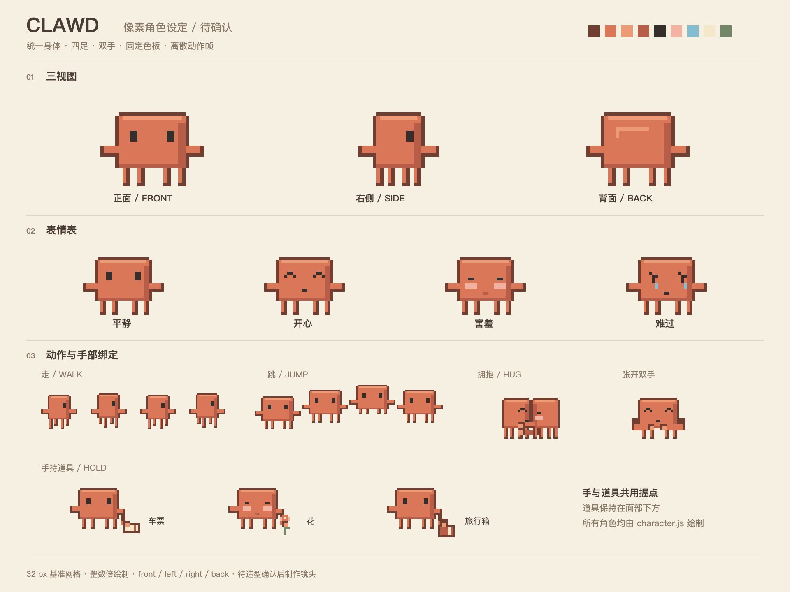
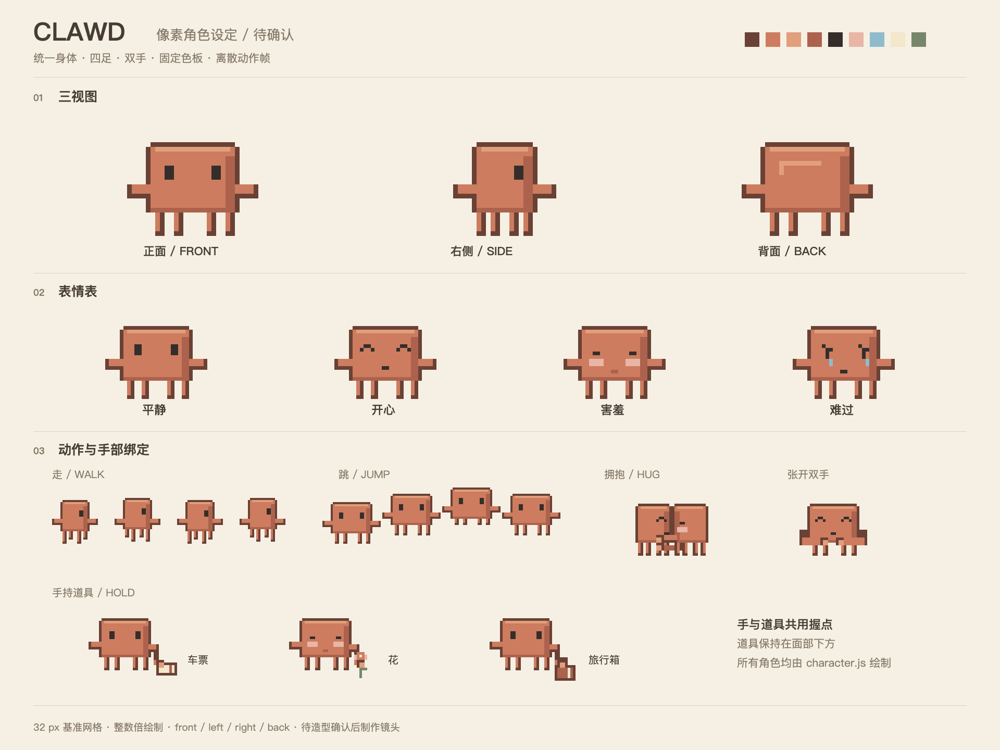

# Clawd 角色设定图视觉验证

- 日期：2026-11-01，Asia/Taipei。
- 改动文件：`assets/clawd/character.js`、`character.test.js`、`character-sheet.html`、`render.mjs`、`README.md`，以及导出 PNG、验证 JSON 和项目记录。
- 页面：<http://127.0.0.1:8765/assets/clawd/character-sheet.html>。
- 浏览器：ego-browser，TaskSpace 3，p1；视口 1920×1440，deviceScaleFactor 1。
- 输出：`assets/clawd/角色設定圖.png`；实际导出与浏览器截图均为非空 1920×1440 PNG。
- 观察：三视图的身体、四足与色板一致，侧面收窄且仅显示一只眼睛，背面隐藏眼睛；开心、害羞、难过可区分。走、跳序列展示离散姿势，双角色相向拥抱；车票、花、旅行箱均贴住手部并保持在脸部下方。文字与角色没有相互遮挡。
- 行为证据：真实 Canvas 测试通过 320 组姿势和 192 组持物组合；像素连通、握点、面部像素保持、确定性、左右镜像、整数倍率、上下文恢复与非法输入检查通过；浏览器错误列表为空。
- 当前范围：角色设定确认图；未制作或验证完整 MV 镜头。

