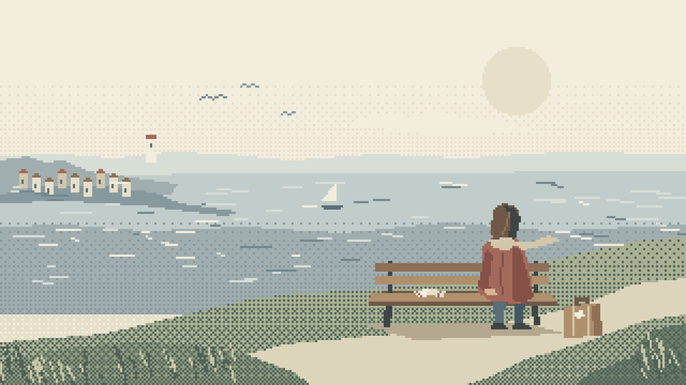
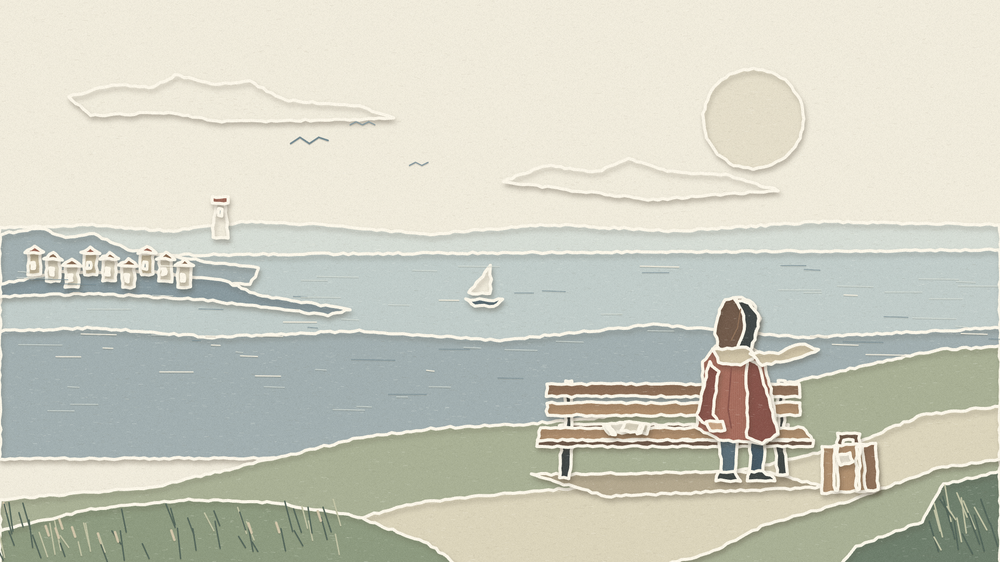
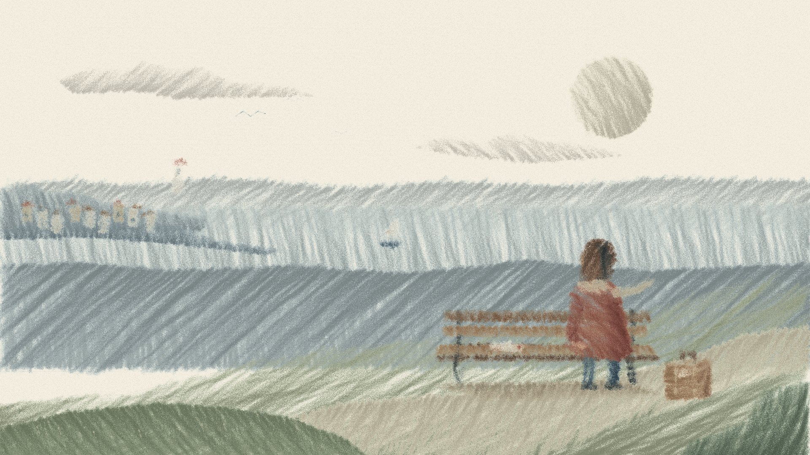

# 开场样图视觉检查

日期：2026-11-01，Asia/Taipei。用户明确要求代码绘制三种 1920×1080 开场样图。

- 改动文件：`會呼吸的痛/開場樣圖/index.html`、`scene.js`、`render.mjs`、三张 PNG、`README.md`、`驗證結果.json`。
- 浏览器：ego-browser TaskSpace 2，p1。视口：1920×1080，截图实测 1920×1080。
- 页面：`http://127.0.0.1:8765/會呼吸的痛/開場樣圖/index.html?style=pixel`，另两页将 `style` 改为 `paper`、`crayon`。
- 取证：`render.mjs` 真实重绘后导出 PNG 与浏览器截图；所有图片非空。原图已通过图像查看工具检查。

| 画风 | 新生成浏览器截图 | 原图观察结果 |
| --- | --- | --- |
| 像素 | [pixel-browser.png](pixel-browser.png) | 整数像素边缘清楚，海面与草地可见点阵；长椅右侧主角、左侧空位与两票、旅行箱、海与港口构图完整，无文本。 |
| 纸艺 | [paper-browser.png](paper-browser.png) | 白色剪边、碎齿撕边和向右下投影形成叠纸层次；纸面可见纤维颗粒；人物、空座、车票和箱子位置与像素版一致。 |
| 蜡笔 | [crayon-browser.png](crayon-browser.png) | p5.brush `crayon` 填色有明显干性蜡笔纹路、露纸空隙及重叠笔触，人物与景物没有裁切，纸张颗粒可见。 |

尺寸、24 色和像素块检查通过；三个页面脚本错误列表为空。材质与构图经过原图检查，动画运动尚未制作或验证。
